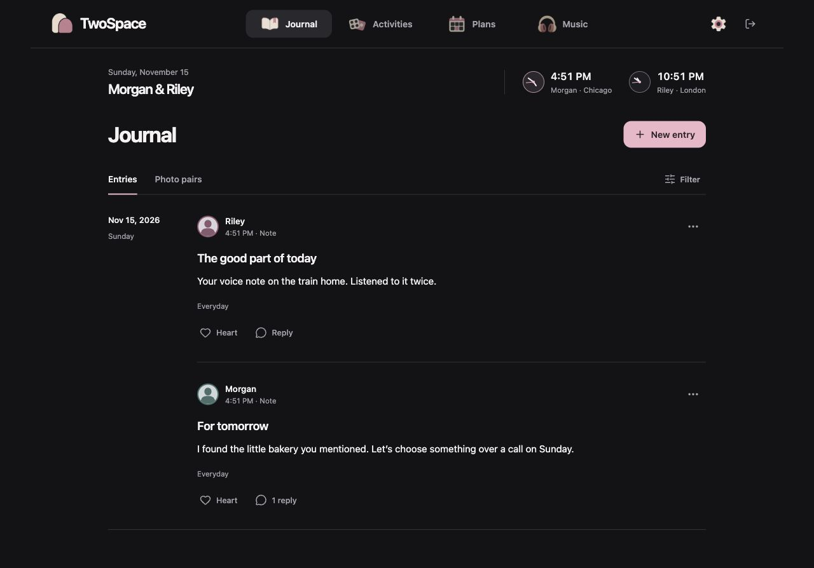
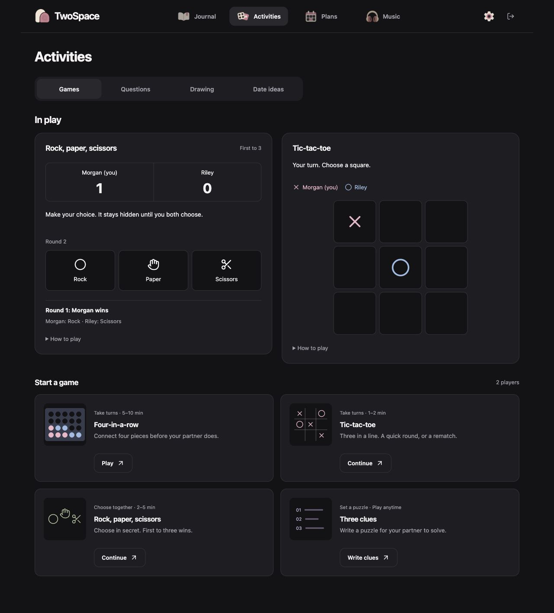
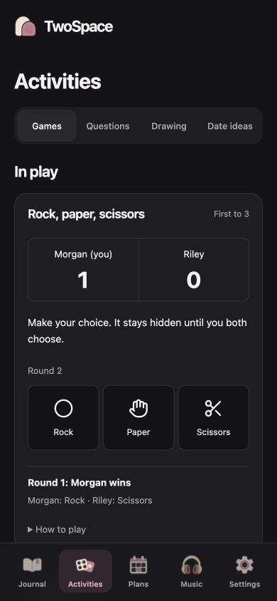

<div align="center">
  
  <h1>TwoSpace</h1>
  <p>A shared journal, games, daily songs, and plans for couples in different places.</p>
  <p>
    <a href="https://twospace.online"><strong>Open TwoSpace</strong></a>
    &nbsp; · &nbsp;
    <a href="#run-locally">Run locally</a>
    &nbsp; · &nbsp;
    <a href="https://github.com/GavinCouch/twospace/releases/tag/v0.1.0">Release notes</a>
    &nbsp; · &nbsp;
    <a href="#iphone-companion">iPhone companion</a>
  </p>
  <p>
    
    
    
    
  </p>
</div>



<p align="center"><sub>Product screenshots use fictional local test accounts.</sub></p>

## Inside the space

| Section        | What you can do                                                                                                                                                               |
| -------------- | ----------------------------------------------------------------------------------------------------------------------------------------------------------------------------- |
| **Journal**    | Write notes, share photos and voice messages, leave replies and hearts, pin entries, and organize collections. Schedule a letter to open later or answer a photo-pair prompt. |
| **Games**      | Play Four-in-a-row, tic-tac-toe, rock/paper/scissors, or Three clues. Turns, hidden choices, rematches, and a running win record are shared; sound effects and win celebrations are optional and respect reduced motion. |
| **Activities** | Answer questions separately before revealing both replies, take turns on a drawing, or save a date idea.                                                                      |
| **Music**      | Pick a Spotify song for the day, attach a note, listen through its official embed, or open it in Spotify.                                                                     |
| **Plans**      | Propose a call, date, or optional visit. See the time in both time zones, compare free hours, and share a checklist.                                                          |

Create an account, make a space, and send your partner an invitation code. Shared features open after both people join. If you both create a space by accident, use **Have their code?** to join your partner from an otherwise empty space; your profile picture moves with you.

Games, everyday messages, and call planning work without an in-person visit. Visit planning is optional.

<details>
<summary><strong>See the games on desktop and mobile</strong></summary>

<br />

<table>
  <tr>
    <td width="73%" valign="top">
      
    </td>
    <td width="27%" valign="top">
      
    </td>
  </tr>
</table>

The phone screenshot shows the responsive website, not the native iPhone companion.

</details>

## Implementation

The web app uses React and TypeScript with the Next.js App Router. TanStack Query owns shared snapshots and cache invalidation; component state handles drafts, filters, and dialogs. Forms use React Hook Form and Zod.

| Area         | Implementation                                                                                                                                                        |
| ------------ | --------------------------------------------------------------------------------------------------------------------------------------------------------------------- |
| Accounts     | Better Auth, email verification and password resets, Google sign-in, local password-strength estimates, and custom profile pictures.                                  |
| Persistence  | PostgreSQL and private object storage in production. The hosted app uses Supabase for the database and files; Better Auth handles authentication.                     |
| Shared state | The client refreshes its snapshot every four seconds while active. Mutations invalidate the cache; failures keep actionable errors visible.                           |
| Game rules   | The server validates players, turns, moves, and revisions. Simultaneous rock/paper/scissors choices remain hidden until both players commit.                          |
| Access       | Membership is checked on the server. Shared APIs require a partner; invitation switches lock the affected accounts and spaces. Private file downloads recheck access. |
| Interface    | Responsive layouts, keyboard-operated tabs and dialogs, focus restoration, labelled controls, status announcements, and reduced-motion support.                       |

Scheduled letters and unanswered question rounds are redacted by the server. Leaving a space locks shared features for the remaining member, who can still export available data and attachments from Settings. TwoSpace does not implement end-to-end encryption.

## Run locally

Use **Node.js 26** and npm, matching CI. The package declares Node.js 24 or later.

```bash
git clone https://github.com/GavinCouch/twospace.git
cd twospace
npm ci
cp .env.example .env.local
npm run dev
```

Open **[http://127.0.0.1:3100](http://127.0.0.1:3100)**. Local development uses SQLite and files in the ignored `data/` directory. No cloud account is needed for the basic app.

To try the shared features, create two local accounts in separate browser profiles or private windows. Create a space in one, then join it from the other with an invitation code.

Google sign-in, password-reset email, and Spotify catalog search need their respective service credentials. Pasted Spotify track links can use the oEmbed fallback without catalog credentials. See [configuration and hosting](docs/configuration.md).

## Checks

```bash
npm test
npm run build
npm run typecheck
```

The [GitHub Actions workflow](.github/workflows/checks.yml) runs the web checks, PostgreSQL integration tests, and the iPhone checks. Building before typechecking supplies Next.js’s generated route types on a clean checkout.

PostgreSQL integration tests are skipped unless a disposable test database is configured. With local PostgreSQL binaries installed:

```bash
PG_BIN=/path/to/postgresql/bin node scripts/test-postgres.mjs
```

The helper starts a temporary cluster, runs the integration suite, and removes the cluster afterward. CI uses PostgreSQL 17. Regression coverage includes cross-space access, simultaneous invitation switches, hidden game choices, scheduled letters, media access, and failed saves.

## iPhone companion

The Expo / React Native companion is **in development** and has not been released on the App Store or TestFlight.

It includes sign-in, partner invitations and joining, notes and photos, replies and reactions, Four-in-a-row, questions, plans, and settings. Music, the other web games, drawing, voice recording, and advanced journal tools are not native screens yet. A JavaScript export is not an installable iPhone app.

For a local simulator build on macOS with Xcode installed:

```bash
cd mobile
npm ci
cp .env.example .env.local
npm run typecheck
npm test
npm run ios
```

The mobile environment example points to the hosted API. Set `EXPO_PUBLIC_API_URL=http://127.0.0.1:3100` to use the local backend from the iOS simulator. Use a development build for native sign-in; Expo Go is not supported for that flow. See [mobile development notes](mobile/development.json) for build limitations and verification status.

## Repository map

```text
src/app/          Pages and API routes
src/components/   Account gate, shared shell, partner setup, query providers
src/features/     Journal, activities, music, plans, settings, and home page
src/server/       Authentication, storage, access checks, and mutations
src/shared/       Types, game rules, drawing, music, and time helpers
tests/            Component, domain, API, and database tests
mobile/           Expo / React Native companion
docs/             Configuration, screenshots, and release notes
research/         Dated research and development records
```

Research files record earlier stages of the project and can contain superseded counts or pending items. The current code, CI, and release notes describe the shipped version.

---

Created by [Gavin Couch](https://github.com/GavinCouch). Brand artwork and the fictional homepage portraits were generated for TwoSpace. Spotify and Google retain their respective branding.
